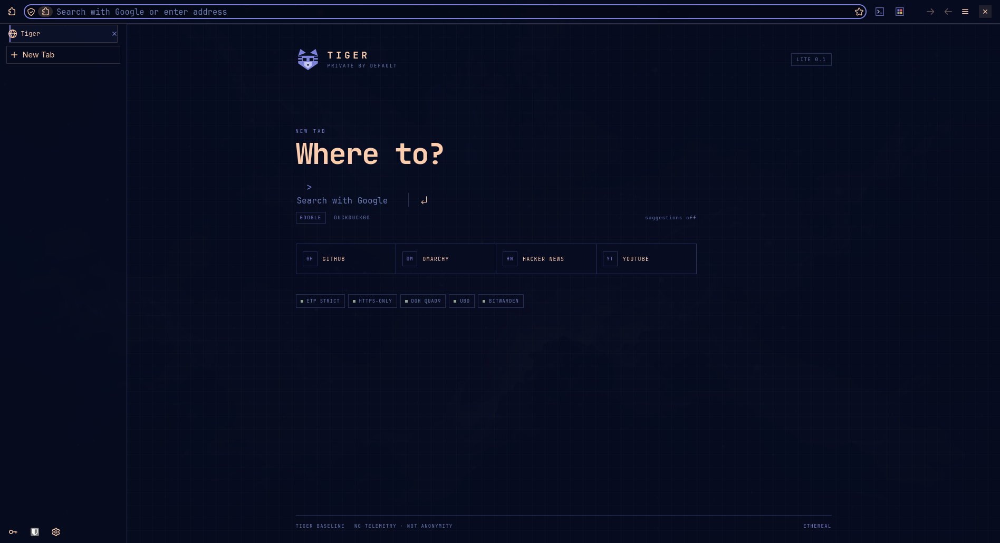
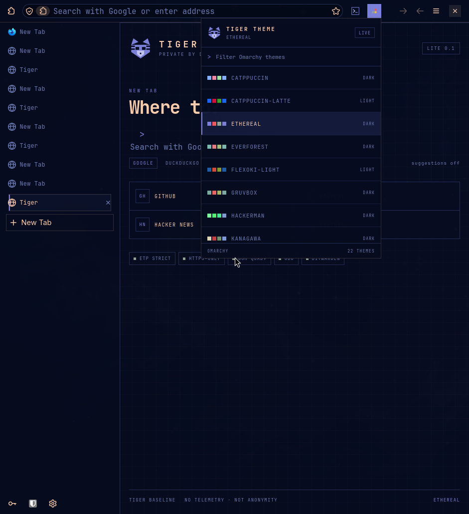
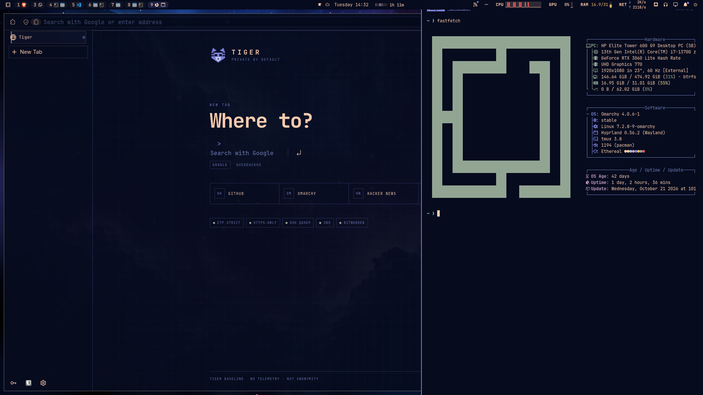

# Tiger Browser

**A privacy-hardened, Omarchy-native Firefox profile.** Vertical tabs, uBlock Origin, Bitwarden, a side terminal, and live Omarchy themes — wrapped in a square, flat, keyboard-first interface.

> **Status: v0.1 “Lite”.** Tiger is not a Firefox fork yet. It runs your system Firefox with a dedicated profile, two signed helper extensions, and a small Rust native host. No engine build, no Flatpak, no AUR package — just a clean profile you can read, audit, and delete.







---

## What you get

- **Vertical tabs by default.** Native Firefox vertical tabs, restyled as square rows with a 2px accent rail.
- **uBlock Origin 1.75.0**, bundled and pinned. EasyList + EasyPrivacy; regional lists can be enabled in uBO’s dashboard.
- **Bitwarden 2026.10.0**, bundled. Firefox’s own password manager is disabled so there is one source of truth.
- **A side terminal.** Click `>_` in the toolbar or press `Alt+Shift+T`. A right-docked `foot` window opens with a persistent `tmux` session; click again to close it.
- **Live Omarchy themes.** Click the four-swatch button or press `Alt+Shift+Y`. The palette lists every theme in `/usr/share/omarchy/themes` and `~/.config/omarchy/themes`; picking one runs `omarchy theme set` and updates the browser chrome immediately.
- **A Tiger new tab.** Square grid, Google search with suggestions off, a one-click DuckDuckGo switch, and a visible Tiger Baseline status row.
- **Tiger Baseline.** No telemetry, no studies, no Pocket, no sponsored tiles, no Firefox Account, no Sync. ETP strict, Total Cookie Protection, HTTPS-Only, Quad9 DoH, permission prompts.
- **A native host that refuses surprises.** Only `terminal.toggle`, `theme.list`, `theme.set` and `theme.current`; fixed binaries, validated theme names, no shell, caller extension IDs pinned.

---

## Requirements

- **Omarchy** with Hyprland (tested on Omarchy 4.0.6 / Hyprland 0.56)
- **Firefox 142 or newer**
- `foot`, `tmux`, `hyprctl`
- `rust`/`cargo` (to build the native host), `curl`, `python3`
- `node`/`npx` only if you want to sign the extensions yourself

If Firefox is missing:

```bash
omarchy install browser firefox
```

---

## Install

```bash
git clone https://github.com/KaplanHalil/tiger-browser.git
cd tiger-browser

# 1. Sign Tiger's two small extensions with your free AMO API key.
#    https://addons.mozilla.org/developers/addon/api/key/
export WEB_EXT_API_KEY="..."
export WEB_EXT_API_SECRET="..."
./scripts/sign.sh

# 2. Install the profile, native host, launcher and icons.
./install.sh

# 3. Start Tiger.
tiger
```

`install.sh` writes only to:

```
~/.config/tiger/                  profile, user.js, userChrome.css
~/.local/lib/tiger/tiger-host     native messaging host
~/.local/bin/tiger                launcher
~/.mozilla/native-messaging-hosts/org.tiger.host.json
~/.local/share/applications/tiger.desktop
~/.local/share/icons/hicolor/*/apps/tiger.png
```

It does **not** touch your default Firefox profile. On upgrade it keeps timestamped backups of `user.js` and `userChrome.css`.

### Why signing?

Release Firefox only installs signed extensions. AMO’s **unlisted** channel is free, does not publish Tiger in the add-on store, and gives you a Mozilla-signed XPI. `install.sh` installs those signed files.

For development without signing, load the built XPIs temporarily from `about:debugging#/runtime/this-firefox` (see `./scripts/dev-run.sh`). Temporary add-ons disappear when Firefox exits.

### Custom paths

```bash
TIGER_PROFILE=~/.config/tiger-work/profile ./install.sh
TIGER_FIREFOX=/path/to/firefox ./install.sh
TIGER_PREFIX=~/.local ./install.sh
```

---

## First run

1. **Bitwarden:** log in to your cloud account and pick the US or EU region. Self-hosted Vaultwarden works too; set the server URL in the extension.
2. **Search:** Google is the default. The new tab has a DuckDuckGo switch; search suggestions are off so keystrokes stay local.
3. **Themes:** open the swatch button (or `Alt+Shift+Y`). Picking a theme changes the whole Omarchy desktop, not just the browser.
4. **Terminal:** click `>_` or press `Alt+Shift+T`. The terminal opens on the right at 40% width with a `tmux` session named `tiger`.

---

## Keyboard

| Key | Action |
| --- | --- |
| `Alt+Shift+T` | Toggle the Tiger terminal |
| `Alt+Shift+Y` | Open the Omarchy theme switcher |
| `Ctrl+T` | New Tiger tab |
| `Ctrl+L` | Focus the address bar |
| `/` | Focus the new-tab search |
| `Ctrl+K` | Focus the new-tab search |
| `Esc` | Clear the new-tab search / close the theme popup |

Standard Firefox shortcuts still apply. The terminal is a normal `foot` window, so your terminal keybindings work inside it.

---

## Privacy and security

Tiger is built around **reducing data collection by default**, not around anonymity.

| Area | Default |
| --- | --- |
| Telemetry, studies, crash uploads | Off |
| Pocket, sponsored tiles, Firefox Suggest | Off |
| Firefox Account / Sync | Off |
| Firefox password manager | Off — Bitwarden only |
| Tracking protection | Strict + Total Cookie Protection |
| HTTPS | HTTPS-Only mode |
| DNS | DoH via Quad9, fallback allowed |
| Notifications | Denied by default; sites can be allowlisted |
| Geolocation / camera / microphone | Ask every time |
| Search suggestions | Off |
| Extensions | uBO, Bitwarden, Tiger Tools, Tiger Theme |

**Honest caveats:**

- Google is the default search engine. Queries go to Google. Switch to DuckDuckGo from the new tab if that is not acceptable.
- Bitwarden is a cloud service. Your vault leaves the machine (encrypted) unless you self-host.
- DoH hides DNS from your ISP but not from Quad9; HTTPS still exposes the destination to the network.
- Google Safe Browsing and Firefox blocklist updates still contact Mozilla/Google infrastructure.
- Tiger is not Tor, not Mullvad Browser, and not an anti-forensics tool.
- The native host is local code. It is deliberately small and restricted, but a compromised Tiger extension would still be able to ask it to toggle a terminal or change a theme.

Read [`docs/BASELINE.md`](docs/BASELINE.md) for every pref, [`docs/PRIVACY.md`](docs/PRIVACY.md) for data flows, [`docs/THREAT-MODEL.md`](docs/THREAT-MODEL.md) for the model, and [`docs/SECURITY.md`](docs/SECURITY.md) for reporting.

---

## How it works

```
tiger
└─ firefox --profile ~/.config/tiger/profile
   ├─ user.js                    Tiger Baseline
   ├─ chrome/userChrome.css      square Omarchy chrome
   ├─ uBlock Origin              pinned signed XPI
   ├─ Bitwarden                  pinned signed XPI
   ├─ tiger-tools                >_ button, new tab, native client
   └─ tiger-theme                theme palette, live theme updates
        │
        └─ native messaging ──> tiger-host (Rust)
                                 ├─ hyprctl / foot / tmux
                                 └─ omarchy theme set/list
```

The host speaks Firefox’s length-prefixed JSON protocol. It only accepts calls from `tiger-tools@tiger-browser.dev` and `tiger-theme@tiger-browser.dev`, validates theme names against the theme directories, and never passes user input to a shell.

Firefox has one toolbar action per extension, so Tiger ships two tiny extensions rather than one extension with a hidden second button.

---

## Repository layout

```
profile/                 user.js + userChrome.css
extension/tiger-tools/   terminal button, new tab, native client
extension/tiger-theme/   theme palette + live theme updates
native/                  Rust native messaging host
branding/                SVG sources + generated PNGs
packaging/               launcher + desktop file
scripts/                 build, sign, check, dev-run
docs/                    baseline, privacy, threat model, security, troubleshooting
versions.env             pinned uBO/Bitwarden versions and SHA256 hashes
install.sh               per-user installer
uninstall.sh             per-user uninstaller (--keep-data keeps the profile)
```

---

## Development

```bash
./scripts/check.sh              # cargo tests, JS syntax, manifests, web-ext lint, XPI build
./scripts/build-host.sh         # release binary in dist/tiger-host
./scripts/build-extensions.sh   # dist/tiger-tools.xpi + dist/tiger-theme.xpi
./scripts/build-icons.sh        # regenerate all PNGs from SVG
./scripts/sign.sh               # AMO unlisted signing (needs API keys)
./scripts/dev-run.sh            # instructions + web-ext command for temporary add-ons
```

The host can be tested without Firefox:

```bash
echo '{"action":"theme.current"}' | ./native/target/release/tiger-host --once
echo '{"action":"terminal.toggle"}' | TIGER_DRY_RUN=1 ./native/target/release/tiger-host --once
```

`TIGER_DEBUG=1` writes errors to `~/.local/state/tiger/host.log`. `TIGER_OMARCHY_BIN` points the host at a fake `omarchy` binary for tests.

### Supported versions

Tiger Lite is tested against the Firefox version in Omarchy’s `extra` repository (currently Firefox 158 / Firefox Developer Edition 160). `userChrome.css` is powerful but not a stable API; after a Firefox major update, check the UI and file an issue with a screenshot.

---

## Known limitations

- Lite uses system Firefox, so the window class is still `firefox`; full window/taskbar branding is a v0.2 rebrand job.
- The new tab is an extension page. Tiger hides the long “Extension (Tiger Tools)” URL-bar label, but Firefox still treats it as an extension origin.
- The side terminal is a floating `foot` window, not an embedded terminal. Wayland does not let one app embed another’s window.
- Theme changes apply to the entire Omarchy desktop.
- The signed XPIs are not committed. You must run `scripts/sign.sh` once.
- No Flatpak, AUR, or auto-update channel yet. Firefox updates through your system package manager; Tiger scripts update through `git pull && ./install.sh`.

---

## Roadmap

- **v0.2** — Flatpak + AUR, a real update channel, extension allowlist policy, `Tiger Shield` status page.
- **v0.3** — optional rebranded Firefox ESR build (own icon/window class), native packaging, reproducible builds.
- **v1.0** — own theme engine, session/workspace integration, docs site, signed releases with SBOM.

---

## Uninstall

```bash
./uninstall.sh            # removes profile, host, launcher, icons
./uninstall.sh --keep-data  # keeps ~/.config/tiger/profile
```

Your default Firefox profile and data are untouched.

---

## Türkçe hızlı başlangıç

Tiger, Omarchy için Firefox tabanlı, gizlilik odaklı bir tarayıcı profilidir: dikey sekmeler, uBlock Origin, Bitwarden, sağa yerleşen terminal ve canlı Omarchy temaları.

```bash
omarchy install browser firefox
git clone https://github.com/KaplanHalil/tiger-browser.git
cd tiger-browser
export WEB_EXT_API_KEY="..."
export WEB_EXT_API_SECRET="..."
./scripts/sign.sh
./install.sh
tiger
```

Kısayollar: `Alt+Shift+T` terminal, `Alt+Shift+Y` tema. Ayrıntılar için [`docs/TROUBLESHOOTING.md`](docs/TROUBLESHOOTING.md).

---

## License

Tiger’s own code is **MIT**. Third-party components keep their licenses; see [`THIRD_PARTY_NOTICES.md`](THIRD_PARTY_NOTICES.md). Firefox is not redistributed by this repository. “Firefox” and “Bitwarden” are trademarks of their respective owners; Tiger is an independent project and is not affiliated with Mozilla, Bitwarden, or Omarchy.

Built by [Halil Kaplan](https://github.com/KaplanHalil).
